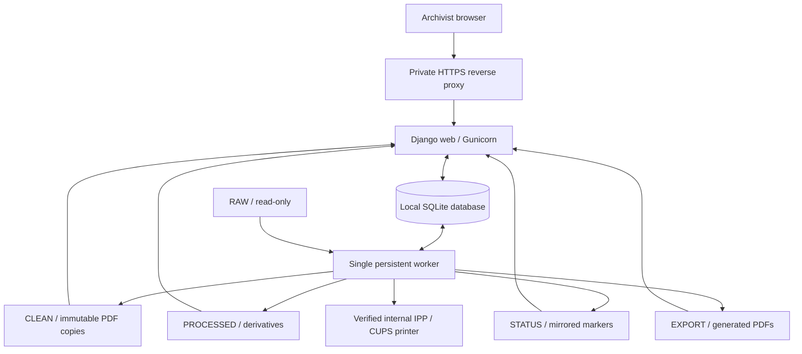

# Notenarchiv & Marschbuch-Generator — Architecture

**Revision:** 2.0 — 2026-11-19  
**Status:** Target design, not a deployed or tested implementation.  
**Normative product requirements:** [REQUIREMENTS.md](REQUIREMENTS.md).  
**Defaults and pending evidence:** [DECISIONS.md](DECISIONS.md).

## 1. System and architectural boundaries

Use a modular Django monolith with a separate, persistent, single-job worker. Both services run the same versioned OCI image. A local SQLite database holds authoritative metadata, jobs and review history. All musical processing and storage remain on the NAS. Target `linux/amd64`, Synology DS224+; assume the base 2 GB RAM until measured. No Redis, Celery, PostgreSQL, SPA, external OCR, CDN or cloud runtime dependency in the baseline. An alternative requires an evidenced architectural decision, not an agent's preference.



Web handles authentication, rendering, forms, catalog/project edits, review intents, job submission, status, and authorized downloads. Worker alone publishes/moves managed archive files, creates markers/derivatives/exports and submits print requests. Both may update local DB through service APIs. A review approval that requires publishing a canonical file remains pending until the corresponding worker operation succeeds; a failed operation must not expose a nonexistent confirmed copy. Keep the original database transaction short; never hold it across OCR or large file I/O.

## 2. Technology baseline

The server and future single-workstation Windows edition share Django, templates,
domain services, database migrations, PDF processing and the job protocol.
The server retains its Compose deployment and DS224+ limits. The desktop target
bundles its runtime and manages its own processes. See [desktop portability](docs/PORTABILITY.md)
for storage and lifecycle boundaries.

| Area | Choice | Notes |
| --- | --- | --- |
| Runtime | CPython 3.12 | Keep development, CI and image in sync; verify actual wheels before locking. |
| Framework | Django 5.2 LTS | ORM, migrations, forms, sessions, CSRF, auth. Pin supported patch versions. |
| Web | Gunicorn + WhiteNoise | WSGI, local immutable static files; initially one app process with a few threads. |
| UI | Django templates, HTMX, Bootstrap or project CSS | German UI, incremental HTML updates, no external assets. |
| Ordering | SortableJS | Bundle locally; server validates complete ordered position IDs. |
| PDF viewer | PDF.js, local assets | Disable PDF scripting/external actions where feasible; same-origin authorization; thumbnails via rasterizer. |
| PDF structure | pypdf | Page info, transforms, merging, preserve vector content when possible. |
| PDF rendering | pypdfium2 | Bounded page rendering, OCR and previews. |
| PDF authoring | ReportLab | Covers, contents, placeholders and basic layout pages; bundle appropriately licensed fonts. |
| Images | OpenCV headless, NumPy, Pillow | Staff-line deskew and conservative image enhancement. |
| OCR | Tesseract 5 through the owned process runner | Local OS packages and `deu+eng`; no separate pytesseract subprocess lifecycle, so existing process-tree limits/cancellation remain authoritative. |
| Recognition | Python `re`, `unicodedata`, RapidFuzz | Explicit rules, aliases, candidate scores, provenance. |
| Files and identity | pathlib, hashlib, uuid, shutil and safe OS primitives | UUIDs for entities, SHA-256 for bytes. |
| Printer | Adapter interface, CUPS client or IPP library | Choose after actual hardware spike. |
| Quality | uv, Ruff, pytest, pytest-django, Playwright, pip-audit, Trivy | Lock Python dependencies; pin tool/actions/assets versions and image digest. |

Use a lockfile (`uv.lock`) and install from it in CI/container. Pin direct dependencies deliberately; avoid installing all optional libraries in WP-01 before they are needed. OCR binaries and native wheels must be verified on amd64. Use local JS assets, languages and fonts; retain notices and versions. License inventory includes Python package metadata, native libraries, OS packages, fonts, vendored JS and transitive dependencies. Do not assume a private container distribution exempts notice obligations. The application license is a separate owner decision. No library/license verification is claimed complete by this document.

## 3. Module boundaries and repository

```text
notenarchiv/
  README.md
  REQUIREMENTS.md
  ARCHITECTURE.md
  IMPLEMENTATION_PLAN.md
  AGENTS.md
  DECISIONS.md
  pyproject.toml / uv.lock         # to be implemented
  Dockerfile / compose.yaml / .env.example
  manage.py
  config/                         # settings, urls, WSGI, startup validation
  core/                           # pure processing; no Django or UI imports
    filesafety/ naming/ pdf/ imaging/ ocr/ matching/ layout/
  apps/
    accounts/ catalog/ members/ archive/ projects/ exports/ printing/ jobs/
  templates/ static/ locale/de/   # local UI and translations
  tests/ fixtures/ scripts/ docs/
  .github/workflows/
```

Use domain services rather than business logic in views or templates. `core` functions operate on explicit safe paths, streams, typed data structures and return results; callers own authorization, job boundaries and persistence. CLI/management commands support maintenance and testing. Django migrations own schema changes. App names may be refined before first implementation if documented; boundaries and single resolution engine are mandatory.

## 4. NAS data and filesystem contract (GR-01–06, AR-01–14)

Example only; do not rename the actual source share or assume these paths exist:

```text
/volume1/Notenarchiv/                          # RAW (existing, read-only)
    Böhmischer Traum/scan001.pdf
    ABBA Medley/Trombone II-III.pdf
/volume1/Notenarchiv_Sortiert/                 # CLEAN
    Böhmischer Traum/Posaune_C_Bassschluessel_02.pdf
    ABBA Medley/Posaune_02-03.pdf
    Italo Pop Classics/Arrangement - A. Beispiel/...
    _Ungeprueft/<source-id>/<safe-name>.pdf
/volume1/Notenarchiv_Aufbereitet/              # PROCESSED
    Böhmischer Traum/Posaune_02__deskew_v1.pdf
/volume1/Notenarchiv_Status/                   # STATUS
    Böhmischer Traum/INDEXSTATUS.json
    Böhmischer Traum/_INDIZIERT_BITTE_PRUEFEN.txt
/volume1/Notenmappen/                          # EXPORT
    Konzertmappe 2027/Personen/Mathias/...
    Konzertmappe 2027/Inhaltsverzeichnis/...
    Einzelnoten/...
/volume1/docker/notenarchiv/
    compose.yaml
    .env
    secrets/django_secret_key
    data/notenarchiv.sqlite3
    data/logs/
    data/thumbnails/
    data/scratch/
```

CLEAN names are human-readable; title is in directory, arrangement subfolder if necessary, instrument and relevant key/notation + part in filename. `02-03` can denote one combined PDF. Store actual structured parts independent of filename. Normalize Unicode and SMB-incompatible/reserved names, control path length, reject case-insensitive collisions. Add short stable ID/version suffix only when needed. Never silently overwrite, even if names are equal; duplicates with identical bytes may be linked in metadata only after validation of musical identity. Keep older copies at unique paths. Moves/renames in managed archives update references through a recoverable operation; snapshots use UUID + hash, not mutable filenames. Distinguish base copies from enhanced derivatives in both filesystem and DB.

### 4.1 Copy and publish protocol

DEC-15 amends cross-platform acceptance: authoritative SQLite metadata retains
transaction/durability/backup guarantees; external-file publication is verified
and recoverable, not an atomic DB/filesystem transaction or a promise that every
namespace operation survives power loss. Existing POSIX directory flushes remain
useful implementation safeguards, not mandatory identical Windows mechanisms.

1. Resolve source by trusted configured root + validated relative path. Reject symlink escapes, special files, absolute/parent traversal and untrusted arbitrary paths. Check source stability (stat/fingerprint before and after reading, retry on change; file descriptor anchored to safe root where feasible).
2. Stream source to a unique staging file on the destination filesystem, calculate SHA-256, verify destination bytes, validate PDF size/structure and source stability. If invalid, record failure and keep it unavailable. Apply limits before expensive parsing. Do not assume file extension is proof of PDF.
3. Reserve destination through DB intent/unique operation ID and serialize filesystem mutations in the worker. Publish only with no-clobber semantics (e.g. same-filesystem hard-link or supported exclusive rename, verified on NAS); `os.replace` is not a no-clobber operation. If a pre-existing file conflicts, compare and choose safe new suffix or report error; never discard it. Flush staged data and relevant directory metadata where supported; recover if crash occurs between DB and filesystem operations.
4. Commit version/file metadata and availability after verified publication. Keep a durable intent with expected hash/path/attempt; reconciliation inspects actual files after restart. Partial staging files are never served. Retention removes only proven unreferenced temporary artifacts; never automatically remove old confirmed versions.
5. Update derived folder status from DB. STATUS mirrors source paths and includes one current marker, counts, timestamp, folder UUID and fingerprint; never names of members. UI displays index and review separately. No writer or marker helper is allowed to write to RAW.

An APPLIED receipt records the verified publication effect, not perpetual file
existence. After interruption, including abrupt OS failure/power loss, detect
missing/mismatched/corrupt referenced files before serving or resolving them as
valid. Mark unavailable and reconcile using persistent intent, expected bytes and
operation-bound proof. Reconstruct only from the exact verified source version
when available; preserve historical metadata and CLEAN, including last surviving
copies. Unknown ownership, conflicts or absent non-reproducible inputs require
actionable review with evidence retained, never blind retry/overwrite. Newly
created directories may be recreated; disposable recovery files may survive or
reappear. Their immediate permanence/removal is not a release requirement.

### 4.1a Isolated processing and workspace lifecycle

Before potentially mutable PDF/OCR/image/external-tool processing, obtain a
physically independent working copy through the validated read-only source
interface. Verify SHA-256 and source identity/metadata stability; close source
handles when no longer needed. Supply only the isolated snapshot to processors,
retain provenance and write outputs to approved writable roots. Never hardlink RAW
as mutable scratch, expose RAW as a writable tool path or publish modified scratch
as byte-identical CLEAN. Enumeration and streaming hashes need no copy; reuse a
verified immutable snapshot for related stages within a job where safe.

Use existing DATA scratch/resource management and isolated job/attempt-owned
workspaces, with collision prevention, path/link validation and bounded disk,
memory and time. Close handles before safe cleanup. Controlled startup/periodic
abandonment cleanup must verify ownership and inactive job state, protect active
workspaces and necessary uncertain-operation proof, and stay inside validated
owned scratch. Never recursively delete an arbitrary configured directory.
Disposable cleanup failure normally warns recoverably without invalidating an
otherwise successful archive operation. Preserve approved/non-reproducible
derivatives and historical artifacts; regeneration requires retained exact inputs
and settings. No second database, distributed transaction or custom storage journal
is needed merely for this contract. These are target obligations, not a claim that
all workspace/reconciliation acceptance is already implemented.

All roots are distinct, not ancestors of one another. Validate host canonical paths before composing mounts and container mount identity/options after launch; inside-container distinct paths alone cannot prove distinct host roots. Avoid auto-creation of missing bind sources (`create_host_path: false` when supported; otherwise explicit host validation). Service-specific access checks: web tests only its writable data directory, worker tests writable managed roots and confirms RAW read-only. Never perform a potentially destructive write to a real RAW archive to validate it; inspect mount flags and test negative permission behavior on a dedicated synthetic deployment. Reject unexpected links in managed paths. No direct web access to staging, arbitrary paths, or secrets.

### 4.2 Index and recognition state

The 2026-11-27 amendment extends verified WP-54/55, not its architecture. Physical
sources/pages, recognition, logical regions, musical identity, selection and print
imposition remain independent. Segmentation is optional: intact booklets remain
usable in original order despite work indexing. OCR uses verified working bytes,
bounded page/region batches, mixed-layer fallback, persistent evidence/progress and
the existing single-heavy-worker queue. Proposals never grant musical confirmation.
Core classification/duration/faceted search extend catalog/library and inheritance/
settings. Effective facets cannot combine unrelated editions; user control visibility
never changes active values. No cloud OCR, external search or Windows write enablement.

Index: walk chosen source folders, inventory files, detect new/changed/missing versions, extract content text and page metadata, create copy and candidate records, update status and queue suitable OCR. Manual-only first delivery uses actual PDF review for scans without text. OCR job can run independently and should use bounded heading regions first; expand to more pages/regions when needed. A filename match is never a reason to skip content inspection. Normalize aliases and part tokens (`II/III`, `2. Trombone`, `Bb`, `Es`, clefs) before comparing evidence; retain candidate provenance, confidence, rule version and region. OCR outputs are local business data, not log text.

States are orthogonal, not one overloaded enum:

| Dimension | Example values |
| --- | --- |
| Source presence | PRESENT, MISSING, CHANGED (inventory flag) |
| Index operation | NEW, INDEXING, INDEXED, PARTIAL_FAILURE |
| Candidate resolution | UNASSESSED, PROPOSED, CONFLICT, UNKNOWN |
| Version review | PENDING, INSPECTED (per reviewer), CONFIRMED, REJECTED; processing/publish failure separately |
| Completeness | UNKNOWN, COMPLETE, INCOMPLETE; per part AVAILABLE, UNREVIEWED, MISSING, NOT_REQUIRED, UNKNOWN |

Review approval applies to exact PDF version/hash and proposed assignments. Manual UI records inspected version + proposal revision; changes to relevant evidence or assignment invalidate that inspection. A batch operation validates all selected records transactionally and only accepts inspected/eligible versions. DB remains authoritative; derive folder review counts, marker and completeness. When source disappears, maintain confirmed CLEAN and show separate missing-source warning. When newer content arrives, it is a new pending version; old confirmed edition can remain available and pinned until owner selects replacement. Explicit reanalysis of unchanged version is allowed without automatic reassignment; changed proposed assignments require review. A full integrity job recomputes hashes, validates references and reports missing/corrupt files without rewriting RAW or silently healing by overwriting confirmed music.

## 5. Domain model

Revision-3 extensions below are the additive target approved by the owner in
DEC-13 on 2026-11-25, with DEC-15's dependency amendment. Shared source/content
implementation follows verified shared portability contracts; remaining native
Windows write/security/packaging acceptance does not block it.
Existing tables and confirmed single-work workflows remain the compatibility
baseline. RecognitionCandidate.region is recognition evidence, not a confirmed
content reference or a sufficient segmentation model.

### Source, content and edition extension

Keep SourceFile/SourceVersion and verified CLEAN copy identities. SourceDocument
provides stable document identity over source revisions. SourcePage identifies
one zero-based PDF page within an exact SourceVersion, with MediaBox, CropBox,
Rotate, UserUnit and page geometry fingerprint. A changed source creates new page
references even if its page count stays equal.

PageRegion has stable identity and immutable revisions referencing a SourcePage.
Store canonical PDF coordinates in points, the effective boxes, units, transform
chain and geometry schema. Derive UI pixel coordinates through an invertible
display transform. Validate finite positive bounds, containment, rotation,
round-trip tolerance and ordering. Rectangles are the initial supported region
shape. A whole-page region is the simple case. Other shapes require a versioned
geometry implementation and acceptance.

LogicalPageRevision references a complete source page or confirmed region and
records orientation and content bounds independently of output size. Ordered
ContentReferences connect work/component + arrangement + playable part/edition
to these logical pages. Multiple references may use one page/region; a content
edition may span many pages/documents. Store explicit occurrence IDs and sequence
numbers. Never infer relationships from equal filenames, page numbers or positions.
ContentEdition groups this confirmed musical sequence. Existing ArchiveAssignment
and PreferredEdition remain usable through a whole-document compatibility adapter.
The shared resolver returns one resolved content edition with a uniform ordered
input contract, including legacy whole-file editions.

Collection and ordered CollectionMembership model independent works. Separate
typed WorkRelationship rows model parent/movement, medley constituent and related
arrangement/edition relationships. Validate cycles and incompatible relationship
types. Preserve equal titles and independent UUIDs. Metadata inheritance keeps
collection provenance and explicit local overrides; snapshot effective values.
The 125-piece booklet remains one source per instrument. Deutsche Messe remains
one parent composition with separately addressable movements. Neither requires
physical PDF splitting.

### Confirmation, publication and compatibility

File validation/publication, segmentation proposals, inspected content revisions,
confirmed musical assignment and completeness remain distinct. A reviewer sees
the actual source context and affected regions before explicit confirmation.
Record actor, exact source hash/page/region revision, ordering and proposal
revision. A changed revision invalidates only affected eligibility for new use,
without mutating older confirmations or outputs. Region approval never derives
from confidence or from opening a thumbnail. Partial collection indexing exposes
only confirmed usable content and reports remaining unknown portions.

ArchiveFile currently carries one arrangement and file-scoped approval constraints.
Do not relax those constraints to force compound copies through legacy services.
The proposed extension adds a document-publication/content-approval path alongside
the legacy adapter. It reuses verified byte-identical CLEAN storage and durable
publication primitives. Confirmed content must pin inspected source/context and
region revisions. Approval of one region cannot advertise the entire file as
musically confirmed. DEC-13 approved this confirmation scope; DEC-15 separates
platform-independent implementation from native Windows writable acceptance.

Keep one neutral, readable compound-source copy under its source/collection
identity. Existing simple piece/arrangement naming still operates unchanged.
Logical work/part names are metadata and derivative download names. Region crops,
rotations, splits and recombinations are PROCESSED/export artifacts with lineage,
never byte-identical CLEAN originals. Generate derivatives on demand, reuse exact
confirmed references and prevent unnecessary source duplication.

### Migration and recovery target

Add nullable/protected relationships and versioned payload schemas first. Backfill
existing validated SourceVersion.page_info into source-page records with stable
mapping receipts. Represent each old ArchiveAssignment as a whole-document content
edition retaining original IDs through an adapter. Do not invent segmentation,
change an approved assignment, duplicate source bytes or reconfirm by confidence.
Ambiguous/incomplete records require manual reconciliation.

Before enabling the new path, compare counts, hashes, source paths, order, edition
preferences, project resolution and export manifests on deterministic legacy
fixtures. Verify idempotent resumable backfill, interrupted migration, concurrent
write exclusion and isolated backup/restore. Keep old snapshot readers and
protected relational pins. New schema readers may extend old inputs through the
adapter. Never rewrite historical payloads or files.

Deploy additive schema with the new path disabled, run integrity reporting, then
enable only after parity tests and the implementation decision. Roll back by
disabling new writes and restoring the tested application/schema-compatible
backup if required. New-schema writes prevent an untested old binary downgrade.
Real-data migration, deployment and irreversible cleanup require separate
authorization. No destructive migration is part of requirements consolidation.

Use UUIDv4 for stable domain identities. SHA-256 is a content fingerprint, not an entity identifier. Numeric UID/GID are deployment only. Use timestamps, protected references, short transactions, indexes on common lookups, DB constraints and service validation. Logical model; fields may be refined in migrations without changing business rules.

### Catalog and members

| Entity | Fields and constraints |
| --- | --- |
| Work | UUID, title, composer optional, normalized search data. Title not unique. |
| WorkAlias | work, alias; unique normalized alias per work. |
| Arrangement | work, arranger, edition/label, active status. Human label can repeat; disambiguate via metadata/ID. |
| InstrumentVariant | family/name, key/transposition, notation/clef, active; canonical variant key with normalized non-null components. |
| InstrumentAlias / RecognitionRule | variant/part target, pattern, scope, priority, version, active. Ambiguous aliases create candidates, not automatic resolution. |
| Part | instrument variant, stable part code/number/label, active; unique normalized code within variant. |
| ExpectedPart | arrangement, part, required/optional, unique pair; no row is not a proof of not required; maintain expectation-defined flag per arrangement. |
| InstrumentationTemplate / TemplatePart | named reusable part expectations; applying copies explicit expectations to an arrangement. |
| Member | name, optional membership ID, active, required regular part. Equal names permitted. Deactivate if referenced. |

### Archive

| Entity | Fields and constraints |
| --- | --- |
| SourceFolder | relative path unique, inventory fingerprint, indexing status, counts; proposed arrangement associations, not exclusive identity. |
| SourceFile | source folder, relative path unique, latest observed size/mtime, presence. |
| SourceVersion | source file, content hash, byte size, page info, observed timestamps; unique (source file, hash). Review state is version-specific. |
| ArchiveFile | direct arrangement FK (nullable only pending/unknown), source version, root kind CLEAN/PROCESSED, relative path, hash, size, kind BASE/DERIVATIVE, derived-from FK, processing profile/version. Unique (root, path); base hash equals source hash; confirmed/usable requires valid arrangement, verified publication and review. |
| ArchiveAssignment | archive file, part, review state; unique pair. Multiple confirmed assignments for a combined PDF. |
| RecognitionCandidate | exact source/version, method, excerpt/region, proposed work/arrangement/parts, confidence, rule version. Local only. |
| ReviewInspection | reviewer, file/version and proposal revision, timestamp; unique appropriate tuple. |
| PreferredEdition | arrangement, part, confirmed archive assignment; unique (arrangement, part), service verifies same arrangement and part. |
| FileOperation | operation UUID, job/attempt, planned and staged paths, expected hash, state; recovery intent. |
| AuditEvent | actor, event, entity ID, timestamp, limited before/after data; local DB, access authenticated. |

All confirmed base files remain byte-identical; derivative must have its own hash and explicit approval for musical use. A corrected arrangement/part changes metadata through review, not bytes. Referenced files/assignments cannot be deleted without a safe, approved migration of references; favor deactivation/retention. Existing confirmed versions remain available unless explicitly withdrawn (e.g. discovered error); historical output files remain immutable and may be marked stale. Avoid exposing withdrawn files in new selections.

### Projects and exports

| Entity | Fields and constraints |
| --- | --- |
| Project | name, status, revision, layout mode REGULAR/MARCHBOOK, custom width/height, cover options, timestamps; duplicate names allowed. |
| ProjectPosition | project, ordered slot index, arrangement nullable for explicit reserve, UUID; unique (project, order), positive order. Number derived from ordered slots; do not store independent editable numbering. |
| ProjectParticipant | project, member FK or guest identity (exclusive), display name snapshot or deliberate refresh, saved default part required, optional project role; unique member per project; guests require valid assignment. |
| ProjectRole | project, role code/label; unique per project. |
| EnsembleMapping | project, role, instrument variant, position nullable for project default, part; unique default by (project, role, variant), unique override by (project, role, variant, position). |
| PartOverride | participant, position, desired part, optional exact confirmed edition; unique (participant, position). Enforce same project. |
| ProjectEditionPreference | project, arrangement, part, edition; unique (project, arrangement, part). |
| PositionEditionPreference | position, part, edition; unique (position, part); arrangement must match. |
| ReplacementRule | scope GLOBAL/PROJECT/POSITION, project/position where required, desired part, replacement part; enforce valid scope and distinct desired/replacement. One rule per scope+desired in baseline; reject cycles and invalid musical combinations. |
| GenerationSnapshot | immutable canonical payload + hash, kind FULL/EXCERPT/ARCHIVE_NOTES/CONTENTS, project nullable only for archive notes, project revision, resolved references, options, report findings, required acknowledgement and actor/time. Pin file/version references through relational rows, not JSON alone. |
| SnapshotInput | snapshot, archive assignment/file/version/hash, position/participant when applicable; protected references. |
| GenerationRun | snapshot, job, state, created/finished, requested output variants. |
| ExportArtifact | run, participant optional (required for FULL and participant-specific EXCERPT), variant READING/PRINT/FALLBACK/CONTENTS, path, hash, media manifest, stale flag/reasons; artifact is immutable. |
| PrintSubmission | artifact/version, target printer, media blocks, copies, confirmation, spool IDs, status including UNKNOWN; no automatic resend. |

A project excerpt is a selection of existing positions and participants in the snapshot, not a new project-level participant-piece list. An archive-note export does not have a participant/project requirement. No full part-only export entity. Reserve positions consume order but have no musical assignment. Duplicating a project remaps position and participant IDs and all associated overrides/preferences. A new arrangement on the same position invalidates incompatible overrides and triggers revalidation; do not silently carry an incompatible choice into generation.

### SQLite and integrity

Use local NAS filesystem only, not SMB/NFS mounted DB. Enable foreign keys. Evaluate WAL on actual local filesystem; configure busy timeout and bounded retry; avoid long transactions. Test SQLite partial unique constraints for nullable scopes; SQLite permits multiple NULLs in normal uniqueness, so use conditional constraints or non-null canonical keys. Do not use PostgreSQL-only `nulls_distinct=False` or rely on `select_for_update` to lock SQLite rows. Cross-table rules (same project, same arrangement, compatible edition) must be checked in services and covered by negative tests. Reordering with unique index uses a two-step temporary offset or other atomic collision-free update in a short transaction, plus optimistic revision compare-and-swap. Protect references and validate DB integrity before publication.

## 6. Resolution engine and matrix

A single server-side resolver returns a structured `Resolution`: position, participant, desired part, actual part, chosen edition/version/hash, part provenance, edition provenance, missing/ambiguous reasons, substitution and warnings. Use it in matrix, preflight, snapshots and project excerpts; never duplicate logic in templates or PDF code.

Resolution order:

1. Personal position override (part and optional exact edition). Otherwise, for an assigned ensemble role, apply explicit position mapping then project mapping for that participant's instrument variant. Otherwise use saved project default. An unresolved required role mapping is reported, not silently guessed. Explicit direct part override bypasses the ensemble mapping for that cell.
2. If an exact personal edition is chosen, verify its confirmed state, arrangement, part and musical compatibility. Otherwise find position preference, project preference, archive preference, or sole suitable confirmed edition, in that order. If multiple suitable choices remain and none preferred, return ambiguity, not arbitrary first row. An invalid explicit preference is surfaced rather than silently replaced.
3. If the desired part has no playable confirmed edition, evaluate the most specific valid substitution (position, project, global). Use same edition resolution for its target; do not substitute merely to hide ambiguity or an invalid explicit choice. Baseline uses one hop, no implicit chain; validate cycles. Display actual substitution. No available target => missing.
4. Reserve => no music and no resolver invocation. Corrupt/withdrawn inputs block or require correction, not a hidden replacement. Missing positions follow acknowledged placeholders.

Matrix UI: HTMX partial updates with CSRF; stable position/participant IDs, project revision, validated choices. Show saved default in column header, effective assignment and both provenance labels in cells; select actual versions with clear notation/key/processing label. Batch edit only selected cells, validate all before transaction, present unavailable/ambiguous issues. Reset explicitly removes overrides. Use prefetching/cached arrangement availability, limited visible rows/columns as needed, fixed headers and filters; no N+1 query explosion. Target functional usability at 100 positions × 50 participants, measure on NAS rather than asserting a latency SLA without evidence. Use actual project data, never hardcode demo examples.

## 7. Generation, layout and printing

### 7.1 Snapshot and output contract

Build preflight with shared resolver in a consistent read snapshot. Include project revision, exact position sequence including reserves, selection, participant names/parts, confirmed versions and hashes, relevant catalog/preference/rule revisions, layout/cover parameters, renderer version and warning/acknowledgement requirements. Canonicalize payload and compute a fingerprint. When user confirms, server validates current relevant dependencies and recomputes or compares fingerprint inside a short transaction; if changed, require fresh preflight. Persist immutable snapshot and pinned relations, enqueue in the same DB transaction. No alternate API can bypass acknowledgement. Worker loads snapshot only; does not resolve mutable project state again. Verify referenced hash/availability before use; on mismatch fail explicitly and preserve old artifacts.

Generate personal full folder(s), per-person excerpt(s), direct archive-note output or contents-only artifact from a common builder. For multi-part direct archive export, output choices must be explicit (separate files or intentional combined PDF). For excerpts preserve current shared order, skip reserves, and include missing placeholders when acknowledged. Full contents are identical in title/number sequence across all participants. Use German generated text; optional cover precedes contents. Never stamp numbers onto notes. Retain pinned manifests and artifact hashes for historical exact reprints. Later project edits or relevant preferred edition changes mark affected artifacts stale, without changing stored bytes. Conservative stale marking is acceptable initially if clearly described; do not mark unrelated outputs as updated.

Publish per-artifact only after verified completeness and use run-level completion status to distinguish a successful batch from partial/failed run; never label partial results as a complete batch. Staging paths tied to run/attempt, cleanup/recovery safe. Suggested human-readable layout: `Project/Personen/<name>/run-<short-id>/{Lese-PDF,Druck-PDF}.pdf`, contents in `Inhaltsverzeichnis/`, archive notes in `Einzelnoten/`. Same name collision disambiguated by short UUID. Old artifacts never overwritten. Store path references relative to configured roots.

### 7.2 PDF core and scan processing

Use pypdf for structure, page rotation and transformation; respect effective CropBox/MediaBox, `/UserUnit`, rotation and tolerances. Reading PDF copies selected pages with original dimensions/orientation/content, without unnecessary rasterization. PDF extraction/merge may change structure/metadata, not source bytes. Disable interactive PDF actions/attachments when building safe outputs where feasible; source and CLEAN remain byte-identical. Use bounded pypdfium2 rendering for OCR/thumbnails/previews, isolated resource-limited subprocesses for risky/long native work. Fonts and generated German text must support Unicode. Use structural/golden tests rather than byte equality for generated PDFs.

Scan pipeline stages: render page with limits; staff-line detection via Hough or robust line estimates; bounded rotation/deskew; conservative noise/shadow cleanup; margin detection with confidence and padding; normalization preserving aspect ratio; preview before/after; publish separate derivative only. Avoid arbitrary aggressive morphology; detect possible loss and flag for human visual review. Unit test stages and compare representative scans privately; synthetic tests do not establish universal preservation of notation. No automatic enhancement of approved base copies.

### 7.3 Layout planner

Pure layout function takes ordered logical pieces and page descriptors and returns physical sheet plan and manifest. For REGULAR, each consecutive compatible A4 portrait run within one position is paired left/right on landscape A3, remainder on A4. Flush run at native A3, landscape/custom page, and piece boundary; never combine generated contents/cover/placeholder with notes. Native A3 stays whole. For unverified landscape/mixed/custom media, preserve page safely and require explicit layout choice if unsupported rather than guessing or cropping. Single-sided default. Marchbook uses configured physical target (170 × 120 mm landscape by default), aspect-ratio-preserving fit, no piece-number overlay. If an original page is too complex or unsuitable, flag preview and require human decision. Fallback A4 scales full native A3 or unpairs A4 spreads from logical inputs as appropriate, after explicit approval; never split native A3. Reading output unchanged. Record actual media dimensions, orientation, page origins and printable-area adjustments in manifest.

### 7.4 Printing

Printer adapter: discover/configure allowed internal printer endpoints, query capabilities and media, submit artifact and observe job IDs/status. Verify actual IPP/CUPS availability (do not presume DSM Print Service is suitable), A3 and custom size, printable margins, paper trays, ordered mixed media and fallback. Initially `PRINT_ENABLED=0`; PDF generation/download unaffected. Use one mixed-media job only after capability and output tests. Otherwise submit sequential contiguous media blocks, not global paper-size batches; warn another spool job may interleave. Avoid extra `number-up` or driver scaling when layout already imposed; validate actual-size print physically. No shell interpolation of filenames; explicit subprocess args/timeout or IPP client. Restrict endpoints to approved internal printers (prevent arbitrary network requests). Persist print intent before submission. If spool acceptance is unknown after crash/timeout, mark UNKNOWN/REVIEW_REQUIRED; do not auto-repeat. A human checks printer and explicitly initiates retry. Print cancellation best effort with actual status, not a claim that paper already printed can be recovered.

### Extended layout target and validation

Extend core/pdf/layout.py, its existing PrintPlan and the isolated composer/render
entry points. Keep the regular schema-1 planner and historical renderer contract
readable. Template-driven plans use a new versioned schema with explicit units
and occurrence IDs. Do not build a second competing composition or resolution engine.

Resolve immutable content first, normalize source coordinates, form ordered final
logical pages, insert covers/contents/configured blanks, calculate per-final-page
binding exclusions, and only then impose final pages on physical front/back slots.
Keep source, content, final-page, sheet and cut/fold geometry separate. A5 two-up
A4 and four-up A3 must yield 2/4 and 4/8 logical pages per simplex/duplex sheet.
Native A3 remains whole. Composite scanner regions require their own confirmation.

For a rectangular content box, proportional maximum fit uses the minimum of
available-width/content-width and available-height/content-height after configured
exclusions. Compare permitted rotations deterministically and use a documented
tie rule. Original/fixed scale must also pass containment. Conservative rectangular
binding exclusions are initially sufficient for complex punch geometry. Preserve
handwriting and source printed numbers. Region recomposition never reconstructs
notation or arbitrarily cuts systems.

Calculate parity independently for each participant's final sequence after all
insertions. Store final-page ID, parity, binding edge/exclusion, sheet number,
front/back side, slot, affine transform, flip edge and cut/fold order. Mirroring
one whole printer sheet is insufficient. Numerical oracles must reconstruct final
reading order after duplex flip, cut-and-stack and fold operations. Verify all
configured orientations/binding edges, mixed source sizes and odd tail pages.

Shared-page policy is explicit per output. Deduplicate complete source pages only
within the configured scope while retaining selected content/occurrence coverage,
extract confirmed regions, or repeat intentionally. Project numbering still belongs
to the common positions/contents and metadata. Full folders have identical work
order even when physical pagination differs. Whole-booklet archive exports remain
independent archive outputs, not a second part-only project-folder mode.

Insertion-compatible replacements pin the earlier final-page sequence, binding
orientation and template revision. A new edition or layout that cannot preserve
the insertion contract is a blocking finding until the user deliberately chooses
an alternative. Standalone excerpts remain distinct.

Preflight validates confirmed region/source revisions, source availability,
containment, protected areas, scaling, slot coverage and front/back correspondence.
Preview renders the exact plan with optional overlays. Final production marks are
explicit options. Preserve vector content and avoid repeated raster recompression.
Pin transforms, effective metadata and template/engine schemas in immutable
snapshots and manifests. New templates never reinterpret old exports.

Validate using independent numerical geometry/permutation checks plus rendered
synthetic visual fixtures, including 125-piece instrumental booklets, Deutsche
Messe, composite scans and annotations at boundaries. Compare equivalent Windows
and Linux results with defined numeric tolerances. Private music/OCR quality and
physical duplex/cutting/NAS checks retain separate acceptance and authorization.
Background analysis uses bounded page/region batches, private scratch, durable
progress and cancellation with one heavy worker. Large-document limits must be
exercised explicitly rather than silently forcing physical file splitting.

## 8. Persistent job framework

Job types: INDEX_SCAN, OCR, INTEGRITY_CHECK, ARCHIVE_PUBLISH/REVIEW, GENERATE, SCAN_PROCESS, PRINT; maintenance backup commands may run outside queue under a documented write barrier. Job UUID, payload schema/version, status, progress, timestamps, cancellation request, error class/sanitized message, lease owner/expiry, attempt token and retry policy. Worker heartbeat independent of currently claimed job; health check observes freshness. One active heavy job across worker instances; enforce global singleton lease or equivalent lock as well as per-job claim. Test accidental duplicate workers.

Use conditional atomic UPDATE for claim and fencing token increments; confirm affected row count, renew periodically; old attempts cannot commit DB result or publish final files. Filesystem operations require serialized publisher ownership and unique staged names; combine fencing checks and durable intent with no-clobber publication and reconciliation so a late attempt cannot replace a current artifact. SQLite transactions do not atomically commit external file writes; design recovery, not an exactly-once promise. A lease expiry does not prove an old process is dead; recover only safely, use process/host locking for the final publisher and ensure cancellation/timeout terminates subprocesses. No automatic PRINT retry. Safe idempotent jobs may retry within limits; distinguish FAILED, CANCELLED (after stopped), SUCCEEDED, and REVIEW_REQUIRED/UNKNOWN. Preserve important audit/snapshot/print history independent of short-lived job logs.

## 9. Deployment configuration and service identity

Create dedicated non-admin DSM service account `svc_notenarchiv`, optionally group `notenarchiv_service`. Determine actual IDs via approved SSH access:

```sh
id svc_notenarchiv
id -u svc_notenarchiv
id -g svc_notenarchiv
```

Use Docker `user: "${APP_UID}:${APP_GID}"`, not image-specific PUID/PGID unless implemented. Configure supplementary numeric group only if tested ACL requires it. No Docker socket, privileged mode, admin password, broad permissions or `chmod 777`. Web users are separate authenticated accounts. Limit service account to required shares; RAW read only, CLEAN/PROCESSED/STATUS/EXPORT/DATA write for worker; archivists generally read CLEAN and use app for changes; original digitalization rights independent. Restrict Compose/secrets to admin and required service read access.

### 9.1 Deployment variables (example, no real secrets)

| Variable | Example/default | Purpose |
| --- | --- | --- |
| APP_IMAGE | `ghcr.io/owner/notenarchiv:0.1.0` | Pinned approved image/tag or digest |
| APP_UID / APP_GID | required actual numeric IDs | Container process identity |
| APP_BIND / APP_PORT | `127.0.0.1` / `8085` | Bind for private reverse proxy; LAN address only when deliberately configured |
| TZ | `Europe/Vienna` | Local timestamps |
| APP_ALLOWED_HOSTS | `notenarchiv.example.invalid,localhost,127.0.0.1` | Explicit host allowlist |
| APP_CSRF_TRUSTED_ORIGINS | `https://notenarchiv.example.invalid` | Approved HTTPS origins |
| SOURCE_HOST | `/volume1/Notenarchiv` | RAW |
| CURATED_HOST | `/volume1/Notenarchiv_Sortiert` | CLEAN |
| PROCESSED_HOST | `/volume1/Notenarchiv_Aufbereitet` | Derivatives |
| STATUS_HOST | `/volume1/Notenarchiv_Status` | Markers |
| EXPORT_HOST | `/volume1/Notenmappen` | Outputs |
| DATA_HOST | `/volume1/docker/notenarchiv/data` | Local DB/logs/cache/scratch |
| SECRET_HOST | `/volume1/docker/notenarchiv/secrets/django_secret_key` | Protected file, not secret contents |
| DJANGO_SECRET_KEY_FILE | `/run/secrets/django_secret_key` | Container path |
| DATABASE_PATH | `/data/notenarchiv.sqlite3` | Local DB |
| SOURCE_DIR / CURATED_DIR / PROCESSED_DIR / STATUS_DIR / EXPORT_DIR | `/archive/raw`, `/archive/clean`, `/archive/processed`, `/archive/status`, `/archive/export` | Internal roots |
| DEBUG_MODE | absent = FALSE | Application diagnostics only |
| OCR_LANGUAGES / OCR_DPI | `deu+eng` / 300 | Defaults, benchmark |
| OCR_TIMEOUT_SECONDS / OMP_THREAD_LIMIT | 60 / 2 | Per region/time and thread limit |
| OCR_WORKERS | 1 | Enforce single heavy job; no arbitrary increase |
| PDF_MAX_BYTES / PDF_MAX_RENDER_PIXELS | 104857600 / 30000000 | Initial limits; validate with fixtures |
| INDEX_INTERVAL_MINUTES | 0 | Manual only baseline |
| PRINT_ENABLED | 0 | Set after hardware verification |
| CUPS_SERVER | optional approved internal endpoint | Only when adapter uses CUPS |
| LOG_LEVEL | derived INFO or DEBUG | Not independent of DEBUG_MODE |

Deployment variables are parsed/validated centrally; business settings (printer, aliases, part rules, expected parts, projects, processing profiles) live in DB. Runtime scratch quota and page/time limits configurable with measured defaults. Never put actual secrets, NAS creds or member data into `.env.example`. Use private GHCR authentication at Docker client, not in app. Confirm HTTPS configuration and trusted proxy behavior; use secure session/CSRF cookies in HTTPS mode, never trust arbitrary forwarded headers from untrusted clients. Local dev may use an explicit loopback-only HTTP profile with synthetic data.

### 9.2 Compose design (illustrative, implementation and NAS checks pending)

The separately approved current-feature test distribution (DEC-10, 2026-11-24)
is implemented under `deploy/synology-test/`. It extends the existing image
entrypoint with the durable worker rather than replacing the queue. The web
retains read-only archive mounts, worker alone gets managed-root writes, and the
mount-free gateway remains the loopback-only private HTTPS backend. Migration
and interactive provisioning take both maintenance and canonical worker locks;
both long-running writers must be stopped. Candidate source Compose is fail-
closed until the publisher packages its actually pulled immutable digest.
`configuration.yaml` and the old preview artifacts retain their historical
web-only scope. Linux software acceptance does not establish DSM ACL/network,
RAM, SQLite or production acceptance.

DEC-09 (2026-11-20) permits an initial web-only technical preview. The shipped
`compose.yaml` starts web and provides explicit one-shot migrate/admin tools;
it does not deploy the worker or processing actions. The full two-service
target below is retained for later WP-05b/WP-07 integration. The preview uses
a loopback-only private HTTPS proxy backend and requires empty/synthetic roots.
Actual container CI exposed that an internal-only bridge cannot publish host
ports. A bounded mount-free TCP gateway from the same image joins the frontend
and internal backend, publishing only loopback. Web retains its internal-only
network and all private mounts; the gateway has no data/archive/secret mounts
and forwards only to the fixed web service. No external proxy image or worker
is added to the preview.

```yaml
x-app: &app
  image: ${APP_IMAGE:?set APP_IMAGE}
  user: "${APP_UID:?set APP_UID}:${APP_GID:?set APP_GID}"
  init: true
  restart: unless-stopped
  read_only: true
  cap_drop: [ALL]
  security_opt: [no-new-privileges:true]
  tmpfs:
    - /tmp:size=128m,mode=1777
  environment:
    TZ: ${TZ:-Europe/Vienna}
    # Optional: uncomment for diagnostics in BOTH services.
    # DEBUG_MODE: "TRUE"
    APP_ALLOWED_HOSTS: ${APP_ALLOWED_HOSTS}
    APP_CSRF_TRUSTED_ORIGINS: ${APP_CSRF_TRUSTED_ORIGINS}
    DJANGO_SECRET_KEY_FILE: /run/secrets/django_secret_key
    DATABASE_PATH: /data/notenarchiv.sqlite3
    SOURCE_DIR: /archive/raw
    CURATED_DIR: /archive/clean
    PROCESSED_DIR: /archive/processed
    STATUS_DIR: /archive/status
    EXPORT_DIR: /archive/export
    OCR_LANGUAGES: deu+eng
    OCR_DPI: "300"
    OCR_WORKERS: "1"
    OMP_THREAD_LIMIT: "2"
    PRINT_ENABLED: "0"
  logging:
    driver: json-file
    options: {max-size: "10m", max-file: "3"}
services:
  web:
    <<: *app
    command: [gunicorn, config.wsgi:application, --bind, "0.0.0.0:8000", --workers, "1", --threads, "4"]
    ports: ["${APP_BIND:-127.0.0.1}:${APP_PORT:-8085}:8000"]
    volumes:
      - ${SOURCE_HOST}:/archive/raw:ro
      - ${CURATED_HOST}:/archive/clean:ro
      - ${PROCESSED_HOST}:/archive/processed:ro
      - ${STATUS_HOST}:/archive/status:ro
      - ${EXPORT_HOST}:/archive/export:ro
      - ${DATA_HOST}:/data:rw
      - ${SECRET_HOST}:/run/secrets/django_secret_key:ro
    healthcheck:
      test: [CMD, python, -c, "import urllib.request; urllib.request.urlopen('http://127.0.0.1:8000/healthz', timeout=3)"]
      interval: 30s
      timeout: 5s
      retries: 3
  worker:
    <<: *app
    command: [python, manage.py, run_worker]
    volumes:
      - ${SOURCE_HOST}:/archive/raw:ro
      - ${CURATED_HOST}:/archive/clean:rw
      - ${PROCESSED_HOST}:/archive/processed:rw
      - ${STATUS_HOST}:/archive/status:rw
      - ${EXPORT_HOST}:/archive/export:rw
      - ${DATA_HOST}:/data:rw
      - ${SECRET_HOST}:/run/secrets/django_secret_key:ro
    healthcheck:
      test: [CMD, python, manage.py, worker_healthcheck]
      interval: 30s
      timeout: 5s
      retries: 3
```

Actual Compose implementation must prevent missing host paths auto-created as empty mounts, add service-specific start checks and validate mount topology. Web can omit RAW when all preview needs use CLEAN; keeping it read-only is acceptable for justified inspection. Use separate bounded disk scratch under DATA for larger jobs, not unlimited tmpfs. Build as non-root, copy local static assets, use minimal runtime packages, no secrets in build layers. Migrations run once under exclusive maintenance before launching both services; management commands need distinct startup validation mode from healthy long-running services. Bootstrap archivist accounts interactively or via protected provisioning, not plaintext passwords in Compose. Ensure health endpoint is minimal and accepts loopback Host header. Start web and worker only after migrations, then health/login checks. Do not claim that sample YAML is a ready-to-run application.

## 10. Debug and logs (OP-04)

```python
raw = os.environ.get("DEBUG_MODE", "FALSE").strip().upper()
if raw not in {"TRUE", "FALSE"}:
    raise ValueError("DEBUG_MODE must be TRUE or FALSE")
DEBUG_MODE = raw == "TRUE"
DEBUG = False  # Django, always
```

Compose default has no active DEBUG_MODE entry; shared environment optionally contains `DEBUG_MODE: "TRUE"`. Recreate web and worker together; validate they report same effective mode, no image rebuild. Deploy INFO+ to container logs only for technical diagnostics; domain audit/status stored separately in DB. Debug DEBUG+ to stdout and `/data/logs/web.debug.log`, `worker.debug.log` with 10 MiB rotation and 5 retained backups per writer (~120 MiB total under two-writer assumption). One process per rotating file; if multiple writers, use per-process files or single listener. Persist logs over restarts, do not delete on mode change. Fail clearly if enabled file logging cannot initialize. Docker log rotation in both modes.

Log fields: ISO timestamp, level, component, service, event, job/correlation UUID, duration, internal file ID and sanitized error. No paths with real member names, secrets, cookies, full OCR text, PDF content or arbitrary untrusted subprocess output. Business review can show excerpts locally in authenticated UI in either mode. Debug menu only when enabled; route authorization and server-side gating, bounded cursor polling, filtering by job/time/level/component, escaped text, sanitized download, no arbitrary log path parameter. Verify previous logs remain inaccessible via GUI in Deploy. No public stack trace.

## 11. Security, resilience and backup

Authentication required for all business pages/APIs/downloads; public health and login only (plus non-sensitive static assets). Same rights for archivists; no custom role model needed. CSRF for mutations, session protection, rate-limit login, Django password hashing; no user-facing production tracebacks. Protect from IDOR/path traversal, malformed PDFs and oversized uploads/processing. Limit process memory/time and subprocess output, isolate native parser/OCR failures. Serve downloads with safe content headers; restrict embedded PDF scripts/actions, avoid treating arbitrary PDFs as trusted HTML. Restrict runtime networking to necessary private printer targets and browser/proxy access; validate actual DSM networking. Local development/CI fixtures synthetic. No real music/member data in remote coding agents, repository, external service or technical logs. Scan secrets and dependencies, patch vulnerable libraries, audit license notices.

Back up full consistent state: stop/quiesce both web and worker mutations, settle file-operation intents, create SQLite backup via Backup API, capture all needed CLEAN/PROCESSED versions, STATUS if non-regenerable, config and securely stored secrets, with manifest of relative paths/hashes. A manifest is not a file backup. Use independent NAS backup (e.g. Hyper Backup) to protected destination; RAW independently covered. Optional exports only if policy permits regenerating them; caches/logs excluded by default. Restore in isolated directories, verify manifest/DB integrity and representative exports, never blindly overwrite live archive. Perform first backup before real archive ingestion and before each migration/update. Periodically test restores.

Update SOP: plan maintenance, stop/quiesce web and worker, capture complete consistent restore point, pull approved exact image, run migrations once, start and smoke test. Rollback requires compatible DB AND file layout; a reversible migration must actually be reversed using compatible code before running the old version. Otherwise restore prior consistent state, acknowledging post-backup changes. No automated production update.

## 12. GitHub, CI and releases

Use feature branches from `main`, small English Conventional Commits, PR review and appropriate green checks. Verify repository plan permits enforced branch protection; otherwise document manual gate. Do not delete existing branches without owner approval. One bounded work package or tightly related subset per PR. CI starts in WP-01 (Ruff + pytest + lock verification), expands with integration tests, browser smoke, image build, container smoke, security and license checks as features exist. Full regression/security checks before release; conditional checks must never skip required affected tests. Pin actions to reviewed SHAs; least privilege `contents: read`; only publish job needs `packages: write`. Build amd64 release from approved tag on main, publish immutable version tag and digest to GHCR with SBOM/provenance where supported. Private registry pull credential scoped to package access, stored outside repo/Compose. No auto deployment; propose commit/push/merge/tag/deploy milestones and execute after owner approval.

Reference commands (after implementation): `uv sync --locked`, `uv run ruff check .`, `uv run ruff format --check .`, `uv run pytest`, `docker compose config`, `docker compose pull`, `docker compose run --rm web python manage.py migrate`, `docker compose up -d`. Exact commands, paths, ACLs and DSM Compose support must be tested and documented in installation runbook. See `IMPLEMENTATION_PLAN.md` for gates and `DECISIONS.md` for pending validation.
