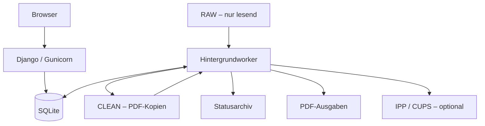

# Notenarchiv & Marschbuch-Generator

Eine lokale Webanwendung zur Verwaltung digitalisierter Vereinsnoten und zur Erstellung von Marschbüchern, Konzertmappen, Unterhaltungsmappen und Notensammlungen für kleine Ensembles.

**Ziel:** Noten einmal digitalisieren, zuverlässig archivieren und für beliebig viele Projekte wiederverwenden. Notenarchivare können Stücke zusammenstellen, Stimmen flexibel zuweisen und vollständige, druckfertige Notenmappen erzeugen – direkt im Browser auf der Vereins-DiskStation.

> **Projektstatus:** In Planung / Entwicklung. Die funktionalen Anforderungen und die technische Zielarchitektur sind dokumentiert. Die beschriebenen Funktionen, Container-Images und Installationsabläufe sind Entwicklungsziele und noch nicht als produktionsreife Software validiert.

## Funktionsumfang

### Notenarchiv und OCR

- Zentrale, durchsuchbare Bibliothek mit sofortiger Titelsuche und Filtern.
- Automatische Erkennung von Musikstücken, Arrangements, Instrumenten, Stimmungen und Stimmen mittels PDF-Text, OCR und Erkennungsregeln.
- Inhaltliche Kontrolle jeder neuen oder geänderten PDF, auch bei eindeutigem Dateinamen wie `Posaune1.pdf`.
- Unterstützung mehrerer Stimmen innerhalb einer PDF, z. B. `Trombone II/III`.
- Prüfwarteschlange mit PDF-Vorschau, erkannten Zuordnungen und manueller Freigabe durch Archivare.
- Erkennung unveränderter und geänderter Dateien anhand von SHA-256-Prüfsummen.
- Vollständigkeitsmatrix zur Identifikation fehlender oder ungeprüfter Noten.
- Separate Scanaufbereitung mit Deskew, Rauschreduktion, Zuschnitt und Formatnormalisierung unter Erhalt musikalischer Zeichen.

### Mitglieder, Instrumente und Stimmen

- Zentrale Verwaltung der Vereinsmitglieder und ihrer regulären Instrumenten- und Stimmenzuordnung.
- Einheitliche Instrumentenbezeichnungen, Stimmungen, Notationsarten und Stimmen über definierte Auswahlfelder.
- Konfigurierbare Ersatzstimmen und stückbezogene Ausnahmen.
- Unterstützung kleiner Ensembles mit getrennten musikalischen und instrumentenspezifischen Stimmen, einschließlich passender transponierter Notenfassungen.

### Projekte und Notensammlungen

Projekte können erstellt, gespeichert, geladen, dupliziert, bearbeitet und archiviert werden, beispielsweise:

- Marschbuch 2026
- Weihnachtsensemble 2026
- Unterhaltungsmappe
- Konzertmappe

Jedes Projekt besitzt genau eine gemeinsame Stückliste mit identischer Reihenfolge und Nummerierung für sämtliche Teilnehmer. Stücke lassen sich suchen, per Drag-and-drop sortieren und nummerieren; freie Nummern sind möglich. Die Teilnehmer werden projektspezifisch ausgewählt.

Die Personalisierung erfolgt ausschließlich über die Instrumenten- und Stimmenzuordnung sowie ein optionales Deckblatt. Individuelle Zusatzstücke oder abweichende Stücklisten sind nicht vorgesehen.

### Direkt bearbeitbare Stimmenmatrix

Stimmenwechsel sind Bestandteil des regulären Workflows. Die Projektansicht bietet eine Matrix mit Stückpositionen als Zeilen und Teilnehmern als Spalten. Über Dropdowns können Stimmen direkt geändert, mehrere Zellen gemeinsam bearbeitet und Ausnahmen auf den Projektstandard zurückgesetzt werden.

| Stück | Mathias | Sebi | Riccardo |
| --- | --- | --- | --- |
| Böhmischer Traum | Pos. 1 | Pos. 2 | Pos. 3 |
| ABBA Medley | Pos. 1 | Pos. 2 | **Pos. 2** |
| Italo Pop Classics | Pos. 1 | Pos. 2 | Pos. 3 |
| Abel Tasman | Pos. 1 | Pos. 2 | **Pos. 2** |

*Beispiel einer projektspezifischen Stimmenverteilung. Riccardos stückbezogene Ausnahmen bleiben beim erneuten Öffnen des Projekts erhalten; die Vereinsstammdaten werden nicht verändert.*

### PDF-Export und Druck

- Ausgabe pro Instrumentenstimme oder pro Teilnehmer.
- Einheitliches Inhaltsverzeichnis mit Stücknummern und Titeln, ohne Seitenzahlen.
- Optionales personalisiertes Deckblatt.
- Getrennte Lese-PDFs mit Original-Seitenformaten und Druck-PDFs mit optimierter Seitenanordnung.
- Prüfbericht vor dem Export mit Ersatzstimmen, fehlenden Noten und individuellen Abweichungen.
- Bei fehlenden Noten: deutliche Warnung, explizite Bestätigung und Platzhalterblatt mit Stücktitel.
- Auswahl eines Netzwerkdruckers sowie Druckvorschau und automatische Papierformatwahl, soweit vom Drucker unterstützt.

| Notenformat | Druckausgabe |
| --- | --- |
| 1 A4-Seite | 1 × A4 |
| 2 A4-Seiten | 1 × A3 quer (links/rechts) |
| 3 A4-Seiten | 1 × A3 quer + 1 × A4 |
| 4 A4-Seiten | 2 × A3 quer |
| Original A3 | A3, ohne Aufteilung |
| Marschbuch | 170 × 120 mm quer (Standard, projektbezogen anpassbar) |

A4-Seiten werden ausschließlich innerhalb eines Stücks gepaart. Bei fehlender A3-Unterstützung wird vor einer geeigneten A4-Ersatzausgabe eine Bestätigung eingeholt.

## Archivprinzip: RAW / CLEAN

**Originaldateien sind unveränderlich.** Die Anwendung erhält ausschließlich Lesezugriff auf das RAW-Archiv. Sie erstellt echte, standardisiert benannte PDF-Kopien in einem eigenständigen CLEAN-Archiv. Keine Originaldatei wird umbenannt, bearbeitet, verschoben oder gelöscht.

```text
/volume1/
├── Notenarchiv/                         # RAW – read-only
│   └── Böhmischer Traum/
│       ├── scan001.pdf
│       └── Trombone II-III.pdf
├── Notenarchiv_Sortiert/                # CLEAN – eigenständige PDF-Kopien
│   └── Böhmischer Traum [arr-a1b2c3d4]/
│       ├── Klarinette_B_02.pdf
│       └── Posaune_C_Bassschluessel_02-03.pdf
├── Notenarchiv_Status/                  # Indizierungs- und Prüfstatus
├── Notenmappen/                         # Generierte Projekt-PDFs
└── docker/notenarchiv/
    ├── compose.yaml
    ├── .env
    ├── secrets/
    └── data/                            # Datenbank, Thumbnails, Logs
```

Die Indizierung prüft Dateiname und PDF-Inhalt, erstellt eine Zielkopie und kennzeichnet den Quellordner über einen separat gespeicherten Status als indiziert. Archivare kontrollieren und bestätigen neue Zuordnungen. **Indiziert, geprüft und vollständig sind getrennte Zustände.** Projekt-PDFs werden ausschließlich aus freigegebenen CLEAN-Dateien erzeugt. Die Quellordner bleiben auch bei erneuter Indizierung und Scanaufbereitung unverändert.

## Technische Zielarchitektur

Die Anwendung ist als modularer Python-Monolith mit Weboberfläche und persistentem Hintergrundworker vorgesehen. Beide Dienste können dasselbe Container-Image verwenden. OCR, PDF-Verarbeitung und Speicherung erfolgen lokal auf dem NAS; keine Cloud, keine Telemetrie und kein externer OCR-Dienst.



| Bereich | Vorgesehene Technologien |
| --- | --- |
| Backend | Python 3.12/3.13, Django, Gunicorn |
| Frontend | Django Templates, HTMX, Bootstrap/CSS, SortableJS, PDF.js |
| Datenbank | SQLite, UUIDs und SHA-256 für Dateiidentität |
| PDF-Verarbeitung | pypdf, pypdfium2, ReportLab |
| Bildverarbeitung | OpenCV, NumPy, Pillow |
| OCR | Tesseract, pytesseract, Regex, RapidFuzz |
| Druck | IPP / CUPS |
| Tests und Qualität | pytest, pytest-django, Playwright, Ruff, pip-audit, Trivy |
| Deployment | Docker Compose, Synology Container Manager |
| CI/CD | GitHub Actions, GitHub Container Registry (GHCR) |

Bibliotheksversionen und Lizenzstrategie werden vor dem ersten Release festgelegt. Die Zielplattform ist die Synology DS224+ (`linux/amd64`).

## Repository-Struktur (geplant)

```text
notenarchiv/
├── README.md
├── REQUIREMENTS.md
├── ARCHITECTURE.md
├── pyproject.toml
├── uv.lock
├── Dockerfile
├── compose.yaml
├── .env.example
├── .gitignore
├── .dockerignore
├── manage.py
├── config/
├── core/                  # PDF-, Bild- und OCR-Verarbeitung
├── apps/
│   ├── archive/           # Import, OCR und Freigabe
│   ├── catalog/           # Stücke, Arrangements, Instrumente, Stimmen
│   ├── members/
│   ├── projects/
│   ├── exports/
│   ├── printing/
│   └── jobs/
├── templates/
├── static/
├── tests/
└── .github/workflows/
    ├── ci.yml
    └── release.yml
```

## Deployment auf der Synology DiskStation (geplant)

Voraussetzungen: DSM mit Container Manager, freier Speicherplatz, getrennte Datenverzeichnisse und ein dediziertes Dienstkonto `svc_notenarchiv` ohne Administratorrechte. Die echte Linux-UID und -GID werden auf der NAS ermittelt und in der Container-Konfiguration verwendet.

Die folgenden Variablen bilden die zentrale Deployment-Konfiguration. Pfade und Werte sind Beispiele und müssen an die tatsächliche NAS angepasst werden.

```dotenv
APP_IMAGE=ghcr.io/OWNER/notenarchiv:0.1.0
APP_UID=REPLACE_WITH_DSM_UID
APP_GID=REPLACE_WITH_DSM_GID
APP_PORT=8085
APP_BIND=127.0.0.1
TZ=Europe/Vienna
APP_ALLOWED_HOSTS=notenarchiv.example.invalid,localhost
APP_CSRF_TRUSTED_ORIGINS=https://notenarchiv.example.invalid
SOURCE_HOST=/volume1/Notenarchiv
CURATED_HOST=/volume1/Notenarchiv_Sortiert
STATUS_HOST=/volume1/Notenarchiv_Status
EXPORT_HOST=/volume1/Notenmappen
DATA_HOST=/volume1/docker/notenarchiv/data
SECRET_HOST=/volume1/docker/notenarchiv/secrets/django_secret_key
```

Verbindliche Volume-Trennung im Compose-Projekt:

```yaml
volumes:
  - ${SOURCE_HOST}:/archive/source:ro
  - ${CURATED_HOST}:/archive/curated:rw
  - ${STATUS_HOST}:/archive/status:rw
  - ${EXPORT_HOST}:/archive/export:rw
  - ${DATA_HOST}:/data:rw
```

Das RAW-Archiv ist zusätzlich auf DSM-Ebene schreibgeschützt. Zugang zur Anwendung erfolgt authentifiziert über das lokale Netz bzw. einen privaten Fernzugriff, vorzugsweise über einen HTTPS-Reverse-Proxy. Bei `APP_BIND=127.0.0.1` ist für den Zugriff aus dem LAN ein Reverse-Proxy erforderlich. Anwendungsdaten und Geheimnisse bleiben außerhalb des Container-Images.

Der vollständige Installations- und Updateablauf wird mit dem ersten getesteten Release bereitgestellt. Ein produktionsfähiges Image ist durch diese Beschreibung noch nicht verfügbar.

### Debug-Modus

Optional lässt sich die Anwendungsdiagnose für Web und Worker über die Compose-Umgebung einschalten:

```yaml
environment:
  DEBUG_MODE: "TRUE"
```

| Einstellung | Betriebsmodus |
| --- | --- |
| Nicht gesetzt | Deploy (Standard) |
| `"FALSE"` | Deploy |
| `"TRUE"` | Debug |

Der Debug-Modus aktiviert eine zusätzliche GUI-Diagnose mit Live-Logs, OCR-Erkennungskandidaten, Verarbeitungsschritten und Laufzeiten. Web und Worker schreiben persistente, rotierende Debug-Logdateien unter `/data/logs/`. Im Standardbetrieb bleiben normale Container-Logs sowie fachliche Fortschritts- und Fehlermeldungen verfügbar.

Beide Modi nutzen dasselbe Container-Image. Django `DEBUG` bleibt deaktiviert, und alle Sicherheitsmechanismen bleiben aktiv.

## Entwicklung und Releases

Geplant ist ein automatisierter GitHub-Actions-Workflow mit Linting, Tests, Sicherheitsprüfungen und Container-Builds. Freigegebene, versionierte Images werden nach erfolgreicher CI in GHCR veröffentlicht. Updates auf der DiskStation erfolgen kontrolliert auf einen konkreten Release-Tag, mit Datensicherung, Migrationen und anschließendem Funktionstest.

Entwicklungsphasen:

1. Projektgrundgerüst, Datenbank, Login, CI und Containerbetrieb.
2. RAW/CLEAN-Import, Archivsuche, Vorschau und manuelle Stimmenzuordnung.
3. OCR, Erkennungsregeln, Prüfwarteschlange und Vollständigkeitsprüfung.
4. Mitglieder, Projekte, Ensemble-Zuordnung, Stimmenmatrix und PDF-Export.
5. Scanaufbereitung und Marschbuch-Pipeline.
6. Intelligentes Drucklayout und Netzwerkdruck.
7. Backup/Restore, Release-Prozess und Abnahmetests auf der DiskStation.

## Sicherheit und Datenschutz

- Ausschließlich authentifizierter Zugriff durch Notenarchivare; kein öffentliches Musikerportal.
- Kein privilegierter Container und kein Zugriff auf den Docker-Socket.
- Originalarchiv immer read-only; alle Schreibbereiche strikt getrennt.
- Keine realen Vereinsnoten, Mitgliederdaten, OCR-Rohtexte, Datenbanken, Tokens oder Zugangsdaten in GitHub, CI-Artefakten oder Issues.
- Tests ausschließlich mit synthetischen bzw. ausdrücklich geeigneten Testdaten.
- Regelmäßige Sicherung von Archiv, Projektdatenbank und bestätigten Zuordnungen. RAW und CLEAN auf derselben NAS ersetzen kein unabhängiges Backup.

## Dokumentation

| Datei | Inhalt |
| --- | --- |
| [REQUIREMENTS.md](REQUIREMENTS.md) | Verbindliche funktionale Anforderungen, Workflows und Abgrenzungen |
| [ARCHITECTURE.md](ARCHITECTURE.md) | Technische Zielarchitektur, Bibliotheken, Datenmodell, Deployment, CI/CD und Tests |

## Lizenz

Die Lizenz des Projekts ist noch festzulegen. Vor einer Veröffentlichung sind die Rechte am Quellcode sowie die Lizenzbedingungen der eingesetzten Bibliotheken und Abhängigkeiten zu klären. Die Rechte an Musikwerken und Notenmaterial sind davon unabhängig.
